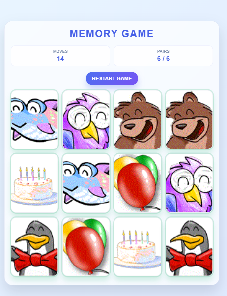

## 🌙 Lunar Memory Game 

A browser-based memory matching game designed to challenge and improve short-term memory. Players flip cards, find matching pairs, and test their concentration through an interactive and engaging gameplay experience.

## ✨ Features

- 🃏 Interactive card-flipping gameplay.
- 🧠 Memory and concentration challenges.
- 🔄 Matching logic to identify identical card pairs.
- 🎨 Clean and engaging user interface.

## 🛠️ Tech Stack

- **HTML5** — Application structure.
- **CSS3** — Styling, layout, and animations.
- **JavaScript** — Game logic, card interactions, and matching functionality.

## live Demo

